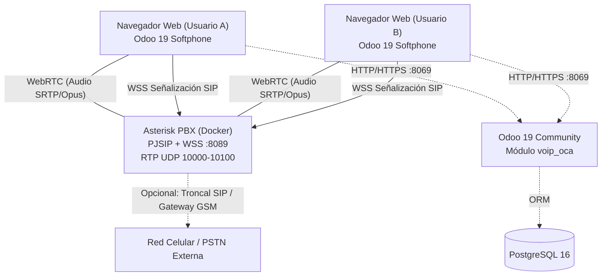

# Solución de Telefonía VoIP WebRTC (Odoo 19 Community + Asterisk PBX)

Este repositorio contiene la solución completa e integrada de telefonía **VoIP WebRTC** para **Odoo 19 Community**, permitiendo a los usuarios realizar y recibir llamadas directamente desde el navegador (sin softphones de escritorio obligatorios), enlazada a una centralita **Asterisk PBX** con soporte de audio de alta fidelidad **Opus**, orquestada mediante **Docker Compose**.

---

## 1. Arquitectura del Sistema



---

## 2. Requisitos Previos

* **Servidor / Máquina:** Linux (Ubuntu 22.04/24.04, Debian 12 o similar).
* **Docker Engine** (versión 24.0+) y **Docker Compose v2** (`docker compose`).
* **Puertos de Red:**
  * `8069/tcp`: Interfaz Web de Odoo 19.
  * `8089/tcp`: WebSocket seguro (WSS) para señalización SIP en Asterisk.
  * `10000-10100/udp`: Tráfico de paquetes de audio en tiempo real (RTP).
  * `8088/tcp`: WebSocket plano (opcional / testing).

---

## 3. Estructura del Repositorio

```text
.
├── README.md                   # Este manual de instalación y operación
├── docker-compose.yml           # Orquestación de Odoo 19, Asterisk y Postgres
├── config/
│   └── odoo.conf               # Configuración base de Odoo
├── asterisk/
│   ├── Dockerfile              # Imagen Alpine con Asterisk, Opus, SRTP y certs TLS
│   ├── http.conf               # Configuración del servidor HTTP/WSS
│   ├── pjsip.conf              # Transportes, plantillas WebRTC y extensiones SIP
│   ├── extensions.conf         # Plan de marcado (llamadas internas y prueba de eco *43)
│   ├── modules.conf            # Módulos de Asterisk y códec Opus
│   └── rtp.conf                # Rango de puertos RTP
└── custom_addons/
    └── voip_oca/               # Addon de telefonía para Odoo 19 (OCA)
```

---

## 4. Despliegue Rápido (Quickstart)

### Paso 1: Clonar el repositorio y levantar los contenedores
```bash
git clone <URL_DEL_REPOSITORIO>
cd odoo19_voip_asterisk

# Construir e iniciar los servicios
docker compose up -d --build
```

Verificar que los tres servicios estén arriba:
```bash
docker compose ps
```

---

### Paso 2: Autorizar el Certificado SSL en el Navegador
Al utilizar certificados autofirmados en local o pruebas:
1. Abrir en el navegador: `https://<IP_O_DOMINIO_DEL_SERVIDOR>:8089/ws`
2. El navegador mostrará una advertencia de seguridad.
3. Hacer clic en **Configuración avanzada** -> **Acceder a <IP> (sitio no seguro)**.
4. *(Esto permite que el navegador acepte la conexión segura WSS con Asterisk).*

---

### Paso 3: Instalar el Módulo `voip_oca` en Odoo 19
1. Ingresar a Odoo como Administrador (`http://<IP_O_DOMINIO>:8069`).
2. Activar el **Modo Desarrollador** en `Ajustes`.
3. Ir al menú **Aplicaciones**.
4. Hacer clic en **Actualizar lista de aplicaciones**.
5. Buscar `Voip OCA` e instalar el módulo.

---

### Paso 4: Configurar la PBX en Odoo
1. Ir a **Ajustes > Técnico > VOIP > PBX** (o desde el menú principal de Telefonía).
2. Crear un registro de PBX:
   * **Nombre:** `Asterisk PBX`
   * **Dominio:** `localhost` (o el dominio/IP de su servidor)
   * **WebSocket Server:** `wss://<IP_O_DOMINIO>:8089/ws`
   * **Modo:** `prod`
3. Guardar el registro.

---

### Paso 5: Asignar Credenciales a los Usuarios
El repositorio viene preconfigurado con dos extensiones de prueba (`1060` y `1061`):

1. Ir a **Ajustes > Usuarios y Compañías > Usuarios**.
2. Seleccionar el primer usuario (ej: Administrador):
   * En la pestaña **VOIP**:
     * **PBX:** Seleccionar la PBX creada en el Paso 4.
     * **Username:** `1060`
     * **Password:** `odoo1060`
3. Seleccionar el segundo usuario (ej: Marc Demo o un segundo comercial):
   * En la pestaña **VOIP**:
     * **PBX:** Seleccionar la PBX creada.
     * **Username:** `1061`
     * **Password:** `odoo1061`
4. Guardar. Al recargar la página, en la barra superior derecha aparecerá el icono del softphone telefónico.

---

## 5. Pruebas de Validación

### A. Monitoreo en tiempo real de Asterisk
Para ver los registros y señalización en la consola:
```bash
docker compose exec asterisk asterisk -rvvv
```

### B. Prueba de Eco (*Echo Test*)
1. En el softphone de Odoo, marcar `*43` y presionar llamar.
2. Permitir el acceso al micrófono si el navegador lo solicita.
3. Se escuchará la locución de bienvenida y un pitido (*beep*).
4. Todo lo que hables por el micrófono se escuchará de vuelta con una fracción de segundo de retraso, confirmando que WebRTC, el códec Opus y los dispositivos de audio funcionan al 100%.

### C. Prueba de Llamada entre Usuarios
1. Iniciar sesión con el usuario `1060` en una ventana normal.
2. Iniciar sesión con el usuario `1061` en una ventana de incógnito o en otra máquina.
3. Marcar desde `1061` hacia `1060`: el softphone de `1060` timbrará con alerta sonora y visual.
4. Presionar **Contestar** y validar audio bidireccional.

---

## 6. Agregar Nuevas Extensiones

Para agregar un usuario nuevo (ej. extensión `1062`):
1. Abrir `asterisk/pjsip.conf` y agregar al final:
```ini
[1062](webrtc_client)
auth=auth1062
aors=1062

[auth1062]
type=auth
auth_type=userpass
username=1062
password=CLAVE_SEGURA_AQUI

[1062]
type=aor
max_contacts=5
remove_existing=yes
```

2. Abrir `asterisk/extensions.conf` y agregar la regla de marcado:
```ini
exten => 1062,1,NoOp(Calling User 1062)
 same => n,Dial(PJSIP/1062,30)
 same => n,Hangup()
```

3. Recargar Asterisk sin reiniciar el contenedor:
```bash
docker compose exec asterisk asterisk -rx "pjsip reload"
docker compose exec asterisk asterisk -rx "dialplan reload"
```

4. Asignar la extensión `1062` en la pestaña VOIP del usuario en Odoo.

---

## 7. Preparación para Producción

1. **Certificados SSL Oficiales (HTTPS y WSS):**
   * En producción (remoto/nube), Google Chrome y Firefox bloquean el micrófono si no se navega bajo HTTPS con un certificado SSL válido.
   * Se recomienda configurar un proxy inverso (**Nginx** o **Traefik**) con **Let's Encrypt** delante de Odoo y Asterisk.
2. **NAT / IP Pública en Asterisk:**
   * En `asterisk/pjsip.conf`, dentro de `[transport-wss]`, agregar la IP pública del servidor:
     ```ini
     external_media_address = TU_IP_PUBLICA
     external_signaling_address = TU_IP_PUBLICA
     ```
3. **Llamadas a Teléfonos Celulares y Números Externos:**
   * Para llamar a celulares y líneas telefónicas tradicionales, se puede conectar Asterisk a:
     * Un **Gateway GSM** físico (marcas como Dinstar con chips de telefonía celular local).
     * O una **Troncal SIP en la nube** (NetUno, Zadarma, Twilio, etc.).
